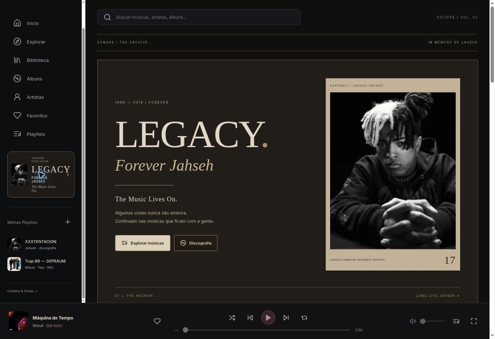
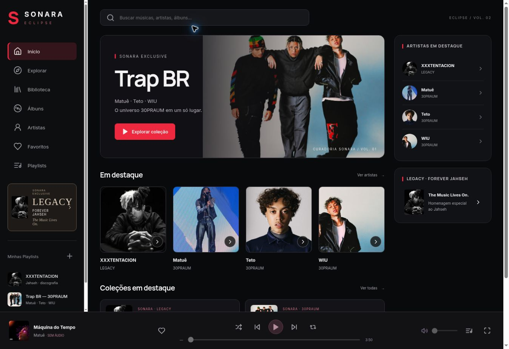
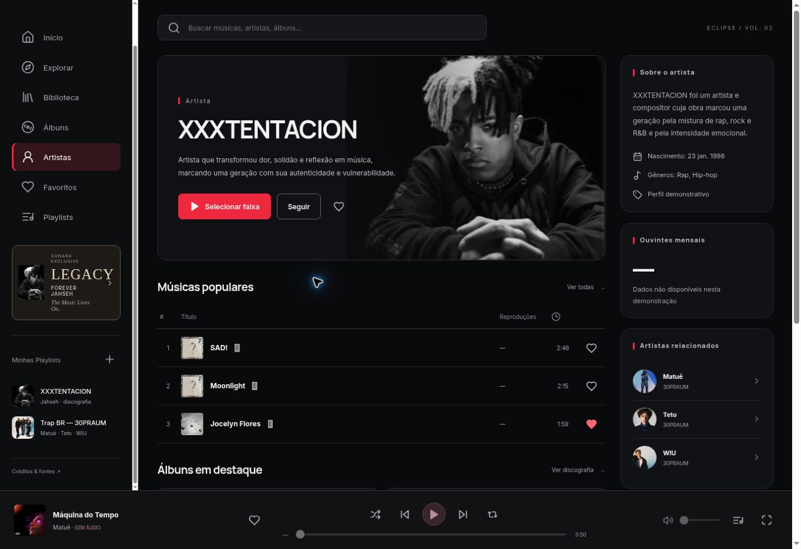
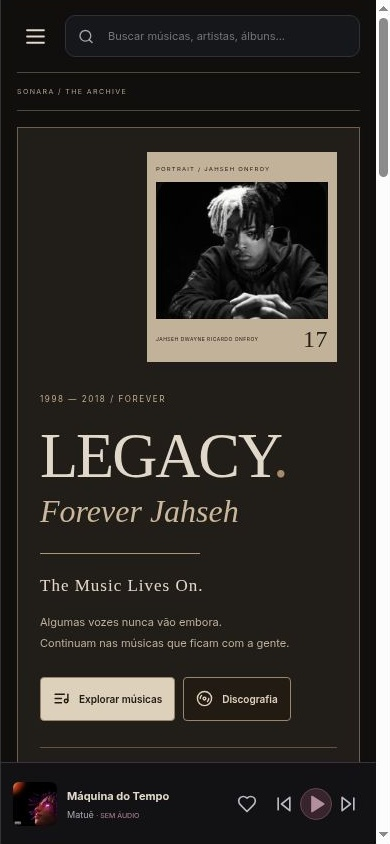
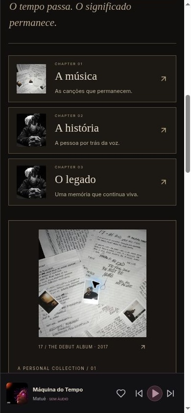
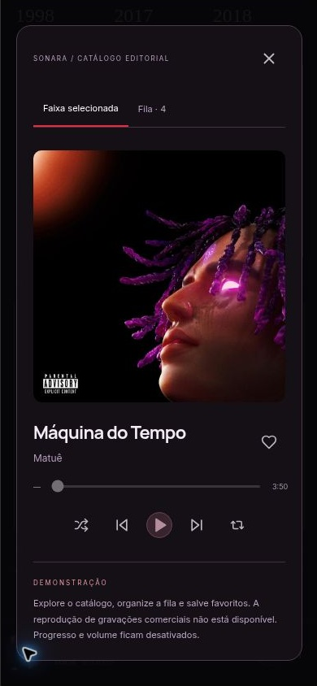
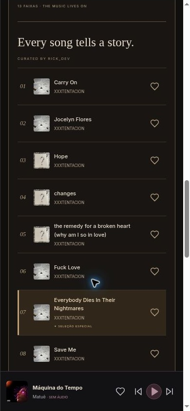
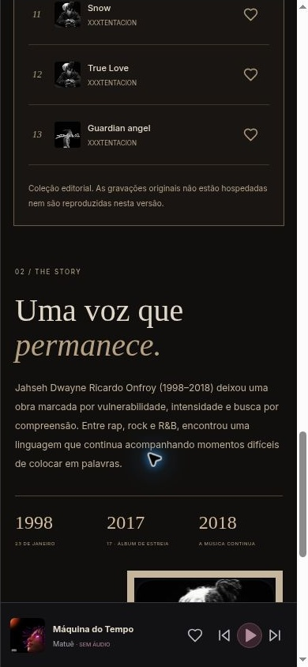
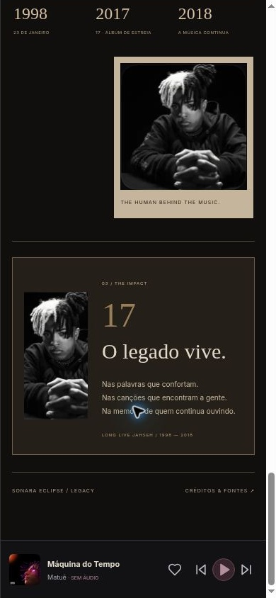

# SONARA ECLIPSE V2 — entrega e validação

Revisão de 8 de novembro de 2026. Base de segurança: `b0712bbdb2e1743d8833921ff883594d9ee66941`, preservada na branch `backup/pre-refinement-2026-11-08`.

## Implementado

- LEGACY extraída em componente próprio e CSS independente. Hero fotográfico, capítulos, coleção FOREVER JAHSEH com as 13 escolhas originais, seleção especial, história, marcos e memorial fotográfico no impacto. Preto, grafite e papel envelhecido preservados.
- Estilos acumulados substituídos por regras consolidadas. Removidos filtros, máscaras, texturas de documento, blend modes, transformações e efeitos de revelação da LEGACY. Fluxo de documento normal com rolagem única e imagens locais; nenhum `!important`.
- Capa 17 original em 1500 × 1500 px do catálogo Apple Music. Mesmo arquivo em cards, lista, coleção e álbum. Área de arte quadrada, `object-fit: contain`, sem filtros ou molduras que reduzam desigualmente sua proporção.
- Home, artistas, discografia e álbuns revisados. Os quatro artistas seguem acessíveis no mobile. Fotografias preservam proporção; WIU possui recorte próprio, em vez do grupo inteiro.
- Player em componente próprio, mini-player, seleção expandida, fila e favoritos integrados. As faixas clicadas selecionam os metadados corretos. Reprodução, progresso e volume indicam claramente a indisponibilidade de áudio; nenhum timer ou áudio fictício.
- Identidade única para faixas, deduplicação da fila e migração dos formatos antigos de favoritos. Separação de favoritos de faixa e álbum. Busca por faixas, artistas e álbuns com normalização de acentos.
- Navegação com hash, links diretos, Voltar/Avançar e retorno ao topo nas trocas de página. Dialog nativo no player; foco, Escape e contenção de teclado no menu mobile.
- Imagens e tracklists antes geradas durante o deploy foram fixadas localmente. Build reproduzível com lockfile e `npm ci`. Workflow não faz downloads mutáveis nem tenta cancelar/deletar um deployment antigo a cada execução.

## Diagnóstico e grau de certeza

**Capa 17 — confirmado:** produção carregava um JPEG de 500 × 500 px; fallback local era outra imagem de 320 × 320 px. A moldura tinha largura e altura externas iguais, mas bordas superiores/inferiores diferentes, criando uma região interna retangular; `object-fit: cover` cortava a arte. Filtros e ampliações agravavam a apresentação. A referência fornecida mostrava uma arte anterior diferente, com baixa definição e um símbolo de play. A nova arte foi verificada visualmente e medida: fonte 1500 × 1500; exibição 220 × 220 no mobile.

**LEGACY no iOS — causa exata não comprovada:** a arquitetura anterior possuía múltiplas camadas de hotfixes, texturas em pseudo-elementos de documento inteiro, filtros, blends e transformações. São riscos de composição removidos pela refatoração; isso não prova qual deles causava a falha relatada. Não existe Safari/WebKit ou iPhone real disponível neste ambiente. O navegador interno do ChatGPT no iPhone também não pôde ser inspecionado.

**Observação durante QA:** uma captura imediata após uma rolagem no navegador remoto registrou pintura incompleta transitória. Na observação seguinte, o conteúdo estava presente e as medições de layout estavam corretas. As capturas estáveis de todos os trechos, até o rodapé, estão anexadas. Portanto, não se declara que qualquer tela preta transitória no iOS foi eliminada com comprovação.

## Testes e resultados

| Verificação | Resultado |
| --- | --- |
| `npm test` | 8 testes aprovados: arquivos, capa, catálogo, identidade, migração de favoritos e fila |
| `python tests/assets.py` | 2 verificações de imagens aprovadas |
| `npm run build` | Aprovado |
| Home, LEGACY, Artista X e álbum 17 | 28 combinações: 320, 375, 390, 430, 768, 1024 e 1440 px; nenhum overflow horizontal medido após a correção |
| Demais páginas, artistas e títulos longos | 11 verificações adicionais em 320 × 568; nenhum overflow medido |
| LEGACY mobile | Percurso do hero ao rodapé em 390 × 844; 13 faixas, imagens presentes e screenshots de cada trecho |
| Player em altura reduzida | 390 × 568: dialog dentro da tela, conteúdo rolável, nenhum overflow horizontal |
| Favoritos | Jocelyn Flores marcada na LEGACY, preservada após reload e reconhecida na busca/player |
| Busca e seleção | Jocelyn Flores encontrada e selecionada; mini-player atualizado corretamente |
| Fila | Seleção de SAD! e Jocelyn Flores conferida; uma entrada por identidade na fila |
| Navegação | Menu mobile abre/fecha, foco colocado no botão de fechar; links para artistas, álbuns e LEGACY verificados |
| Áudio comercial | Reprodução e progresso desabilitados; estado de demonstração explícito |
| Revisão independente | Sem crash crítico em rotas válidas; inconsistência importante de IDs identificada e corrigida com testes |

As medidas completas estão em `responsive-results.json` e `extra-responsive-results.json`. As larguras informadas correspondem ao viewport do iframe de teste, com a largura de conteúdo descontando a barra de rolagem do Chrome.

## Evidência visual

| LEGACY mobile | Coleção e capítulos | Player mobile |
| --- | --- | --- |
|  |  |  |

Screenshots mobile são recortes exatos do viewport 390 × 844 registrado no navegador remoto. As capturas completas correspondentes estão em `screenshots/raw/`.

## Limitações

- A aprovação específica de Safari iOS / navegador interno do ChatGPT permanece não verificada. Chrome responsivo não equivale a WebKit real.
- Fotografias da homenagem preexistentes não tinham autoria/licença documentadas. Foram preservadas, sem declarar uma licença aberta. A página `credits.html` documenta fontes conhecidas e essa limitação. A imagem da capa pertence a seus titulares e é referência editorial, sem alegação de licença aberta.
- O catálogo continua demonstrativo, com lançamentos em catalogação. Nenhum streaming comercial foi adicionado.
